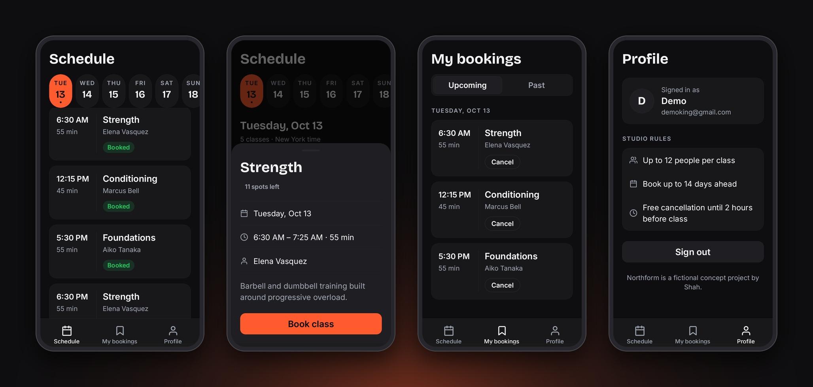

<div align="center">

# Northform

**Book strength and conditioning classes from your phone.**

An Android app for Northform, a fictional boutique strength studio. Live schedule, instant booking, and rules enforced by the database.


**[Download the Android APK](https://github.com/YezolAIorganization/northform-app/releases/latest)** · [Web companion](https://northform-web.vercel.app)

<sub>Northform is a fictional concept project by Shah. The studio, trainers and classes are not real.</sub>

</div>

<br>



## What it does

- Email sign-up and login, with the session kept after the app closes
- 14-day schedule with a day strip, class cards and loading skeletons
- Class sheet with instant (optimistic) booking and toast feedback
- My bookings with Upcoming and Past tabs, and cancel with automatic rollback if the request fails
- Offline banner when the connection drops
- Dark-only design system with an ember accent

## Rules enforced in the database

- Maximum 12 people per class
- Book up to 14 days ahead
- Free cancellation until 2 hours before class
- Studio timezone: America/New_York

These are Postgres functions with Row Level Security, not just UI checks, so they hold even if the client is modified.

## Tech stack

- Expo with Expo Router, React Native, TypeScript
- Supabase: Auth, Postgres, RLS, RPC functions, scheduled class generation (pg_cron)
- EAS Build for the Android APK

## Run it locally

You need a Supabase project with the same schema (tables, views, and the `book_class` and `cancel_booking` functions).

```bash
npm install
```

Create `.env.local` in the project root:

```bash
EXPO_PUBLIC_SUPABASE_URL=your-project-url
EXPO_PUBLIC_SUPABASE_ANON_KEY=your-publishable-key
```

```bash
npx expo start
```

Only the publishable (anon) key is used in the app. Never put a service-role key in this project.

## Build an APK

```bash
eas build --platform android --profile preview
```

## License

MIT. See [LICENSE](LICENSE).
